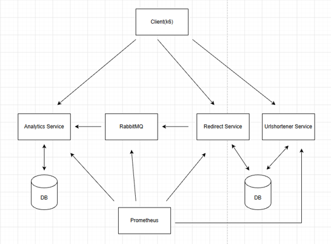

# Master's Thesis: Performance Evaluation of a Microservice Application on Azure Kubernetes Service

An empirical comparison of horizontal and vertical scaling of a Go microservice application (a URL shortener and redirect system) on Azure Kubernetes Service, measuring capacity, response time and resource usage under stepwise load generated with k6.

| | |
|---|---|
| **Original title (Serbian)** | *Evaluacija performansi mikroservisne aplikacije u Azure Kubernetes Service okruženju na primeru redirect aplikacije* |
| **Degree** | Master's degree (Master Academic Studies), Electrical and Computer Engineering |
| **Study programme** | Power Software Engineering (*Primenjeno softversko inženjerstvo*) |
| **University** | Faculty of Technical Sciences, University of Novi Sad |
| **Mentor** | Sebastijan Stoja, PhD, Assistant Professor |
| **Year** | 2026 |
| **Language** | Serbian, with an English abstract |

📄 **[Read the full thesis (PDF, in Serbian)](master-thesis.pdf)**

## Abstract

This thesis examines the impact of horizontal and vertical scaling on the performance of a microservice application, using a redirect application as an example, in an Azure Kubernetes Service environment. The application was subjected to stepwise increasing load generated with k6. In controlled experiments, the number of replicas, the size of the application node and the size of the database node were varied, while capacity, response time and resource utilization were measured.

## Thesis Goal

The task of the thesis was to:
- Study microservice architecture, horizontal and vertical scaling strategies, and methods for measuring the performance of web systems
- Develop a microservice redirect application instrumented to measure throughput, latency and resource utilization, and deploy it on Azure Kubernetes Service
- Define the measurement procedure, load profile and capacity criterion, and run experiments varying the number of replicas, the application node size and the database node size
- Determine which scaling strategy provides more capacity **for the same total amount of CPU**, and to what extent the difference is explained by the number of connections to the shared database

### Research questions
1. Which component consumes the most CPU time per request, and does memory usage grow with load?
2. How does performance change with horizontal scaling (more replicas, same node size)?
3. How does performance change with vertical scaling (bigger nodes, same number of replicas)?
4. Which strategy provides more capacity for the same total CPU, and how large is the difference?
5. To what extent is that difference explained by the number of database connections the replicas hold?

## Features

The application is a URL shortener used as the measurement instrument for the experiments:
- **Shorten a URL:** submit a long URL and get a short code
- **Redirect:** opening a short code redirects the visitor to the original URL (HTTP 302)
- **Track visits:** every visit is recorded asynchronously
- **View statistics:** total visits per code, visits in the last 24 hours and the time of the last visit

## Architecture



The system consists of three Go services, two PostgreSQL databases and a message broker:

| Component | Responsibility |
|---|---|
| **Urlshortener Service** | Generates short codes and stores the code–URL links |
| **Redirect Service** | Looks up the original URL for a code and redirects the visitor; the measured path |
| **Analytics Service** | Consumes visit events, stores them in batches and exposes visit statistics |
| **Links database** (PostgreSQL) | Shared by Urlshortener (writes) and Redirect (reads) |
| **Analytics database** (PostgreSQL) | Used only by the Analytics service |
| **RabbitMQ** | Delivers visit events from Redirect to Analytics |

- **Synchronous path:** the redirect is a single indexed database query followed by an immediate response
- **Asynchronous path:** Redirect publishes the visit to RabbitMQ without waiting, so recording visits never adds to redirect latency
- Each service exposes a **public port** for traffic and a separate **management port** for health checks and metrics, so monitoring doesn't affect the measured traffic
- All services are **instrumented with Prometheus metrics**: HTTP request rate and latency histograms, database query duration, connection pool usage and wait time, and message publish/consume counts

### Deployment on AKS
- Each service runs as a **distroless Docker container** built with a multi-stage Dockerfile
- Kubernetes manifests are applied in a **numbered order** (namespace, config and secrets, migration jobs, deployments, services)
- The cluster is split into **five node pools** (system, support, app, db, loadgen) so every measured component runs on its own node and its resource usage can be attributed exactly
- Only one Redirect pod runs per node, and **cluster autoscaling is disabled** so the configuration never changes during a measurement
- The k6 load generator runs **inside the cluster** on its own node, so no external load balancer affects the results

## Methodology

- **Dataset:** 500,000 links, generated deterministically so every run starts from identical data
- **Load model:** open model with stepwise increasing request rates of **4,000, 8,000, 14,000 and 22,000 requests/s**, 90 seconds per step
- **Capacity:** the highest step a configuration sustains while keeping the **95th percentile response time under 200 ms**
- **Metrics sources:** service metrics collected by Prometheus, CPU and memory per container from cAdvisor, and client-side latency from k6
- Every configuration was run **three times** from the same initial state to check repeatability

| Experiment | What changes |
|---|---|
| 1 and 2 | Request mix across all three services, to measure resource usage per component |
| 3 | **Horizontal scaling:** 2, 4 and 8 Redirect replicas on 2-vCPU nodes |
| 4 | **Vertical scaling:** 2 Redirect replicas on 2, 4 and 8-vCPU nodes |
| 5 | Database node size (2, 4 and 8 vCPU, with matching buffer memory) |

## Results

| Strategy | Configuration | Capacity (requests/s) |
|---|---|---|
| Horizontal | 2 replicas | 8,000 (14,000 in one of three runs) |
| Horizontal | 4 replicas | 14,000 (22,000 in two of three runs) |
| Horizontal | 8 replicas | 22,000 in all runs (the highest tested step) |
| Vertical | 2 replicas on 2, 4 or 8-vCPU nodes | 14,000, none reached 22,000 |

- **Horizontal scaling increased capacity.** Connection wait time dropped as replicas were added, and the CPU was never exhausted in any configuration. The trade-off is slightly higher total CPU usage for the same work.
- **Vertical scaling did not increase capacity.** Bigger nodes add CPU but not database connections, so most of the added cores stayed unused and throughput at saturation rose by only 6% and 12%.
- **For the same total CPU, horizontal scaling gave 38% more capacity with 8 cores and at least 57% more with 16 cores.**
- **Answers to the other questions:** the Analytics service uses the most CPU per request, and memory usage doesn't grow with load, so memory is never the bottleneck. A bigger database node reduces connection wait time but doesn't change capacity.

## Conclusion

The capacity of the service is limited not by CPU, but by the **number of connections to the shared database** and how long each replica holds a connection. Horizontal scaling raises capacity because every new replica brings its own connection pool, while vertical scaling leaves the number of connections unchanged. Neither strategy removes the bottleneck; horizontal scaling only moves it further.

The main lesson: before scaling, find the real bottleneck, because adding CPU doesn't help if the limit is somewhere else.

## Future Improvements

As discussed in the conclusion of the thesis:
- Extend the load beyond 22,000 requests/s to find the true capacity of the 8-replica configuration
- Test vertical scaling with a connection pool that grows with the number of CPU cores

## Tech Stack

Go, Gin, pgx, PostgreSQL, RabbitMQ, Docker, Kubernetes, Azure Kubernetes Service (AKS), Prometheus, cAdvisor, Grafana, k6

## Repository Structure

```
master-thesis/
├── master-thesis.pdf          # the full thesis (in Serbian)
├── images/                    # architecture diagram
└── src/
    ├── services/
    │   ├── urlshortener-service/
    │   ├── redirect-service/
    │   └── analytics-service/
    └── deploy/
        ├── k8s/azure/         # Kubernetes manifests for AKS, one folder per component
        ├── loadtest/          # k6 load test scripts
        ├── results/           # raw measurement results of the experiments
        └── seed/              # dataset generation for the links database
```

Each service in `src/services/` follows the same layout: `cmd/` (entry point), `internal/` (application logic), `pkg/` and `platform/` (shared infrastructure code), plus its own `Dockerfile` and Go module.

## Running the Application

All commands are PowerShell and are run from the `src/` folder. Everything is deployed to the `redirect-application` namespace.

### Prerequisites
- An **Azure subscription** with the **Azure CLI** installed
- **kubectl** and **Docker**
- An **Azure Container Registry** (or another registry) for the service images

### 1. Create the AKS cluster and node pools

Each node pool gets a `workload` label, which the manifests use to place every component on its own node. Cluster autoscaling stays off.

```powershell
$RG = "rg-msc-thesis"; $AKS = "aks-msc-thesis"; $ZONE = "1"

az aks nodepool add -g $RG --cluster-name $AKS -n supportpool --node-count 3 --node-vm-size Standard_D2s_v5 --labels workload=support --zones $ZONE
az aks nodepool add -g $RG --cluster-name $AKS -n dbpool      --node-count 2 --node-vm-size Standard_D4s_v5 --labels workload=db      --zones $ZONE
az aks nodepool add -g $RG --cluster-name $AKS -n loadgenpool --node-count 1 --node-vm-size Standard_D8s_v5 --labels workload=loadgen --zones $ZONE
az aks nodepool add -g $RG --cluster-name $AKS -n apppool     --node-count 2 --node-vm-size Standard_D2s_v5 --labels workload=app     --zones $ZONE
```

The `apppool` is the one that changes between experiments: its node count must match the number of Redirect replicas (one pod per node), and its VM size is the node size being tested.

### 2. Build and push the images

```powershell
docker build -t <registry>/urlshortener-service:latest services/urlshortener-service
docker build -t <registry>/redirect-service:latest     services/redirect-service
docker build -t <registry>/analytics-service:latest    services/analytics-service
docker push <registry>/urlshortener-service:latest
docker push <registry>/redirect-service:latest
docker push <registry>/analytics-service:latest
```

Update the image names in the deployment manifests to point to your registry.

### 3. Deploy

```powershell
kubectl apply -R -f deploy\k8s\azure\
kubectl -n redirect-application rollout status deploy/postgres-urlshortener --timeout=900s
kubectl -n redirect-application rollout status deploy/postgres-analytics    --timeout=900s
```

This creates the namespace, config and secrets, runs the database migration jobs, and starts PostgreSQL, RabbitMQ, Prometheus, Grafana, the three services and the k6 runner. To change the number of Redirect replicas:

```powershell
kubectl -n redirect-application scale deploy/redirect-service --replicas=8
```

### 4. Seed the dataset

Insert the 500,000 links into the links database. The codes are generated deterministically, so every run starts from identical data:

```powershell
kubectl -n redirect-application wait --for=condition=complete job/urlshortener-service-migrate --timeout=600s
Get-Content deploy\seed\seed-urlshortener.sql | kubectl -n redirect-application exec -i deploy/postgres-urlshortener -- psql -U appuser -d urlshortener
```

### 5. Run an experiment

Before every run, restart the services and reset both databases, so no state carries over between runs:

```powershell
kubectl -n redirect-application rollout restart deploy/redirect-service deploy/urlshortener-service deploy/analytics-service
kubectl -n redirect-application rollout status deploy/redirect-service --timeout=600s

kubectl -n redirect-application exec deploy/postgres-urlshortener -- psql -U appuser -d urlshortener -c "DELETE FROM links WHERE id > 500000;" -c "VACUUM FULL ANALYZE links;" -c "SELECT pg_prewarm('links');" -c "SELECT pg_prewarm('links_code_uidx');" -c "SELECT pg_stat_reset();" -c "CHECKPOINT;"
kubectl -n redirect-application exec deploy/postgres-analytics -- psql -U analyticsuser -d analytics -c "TRUNCATE clicks;" -c "VACUUM ANALYZE clicks;" -c "CHECKPOINT;"
```

Copy the load test script and the list of existing codes into the k6 pod, then start the test. k6 sends its results to Prometheus via remote write:

```powershell
$pod = kubectl -n redirect-application get pod -l app=k6 -o jsonpath='{.items[0].metadata.name}'
kubectl cp deploy\loadtest\case34.js  redirect-application/${pod}:/tmp/case34.js
kubectl cp deploy\loadtest\codes.json redirect-application/${pod}:/tmp/codes.json

kubectl -n redirect-application exec $pod -- sh -c "cd /tmp && nohup env K6_PROMETHEUS_RW_SERVER_URL=http://prometheus:9090/api/v1/write K6_PROMETHEUS_RW_TREND_STATS='avg,p(90),p(95),p(99),max' k6 run -o experimental-prometheus-rw case34.js > /tmp/k6.log 2>&1 &"
```

`case1a.js` is used for the first two experiments (resource usage per component), and `case34.js` for the scaling experiments with stepwise load of 4,000 to 22,000 requests/s.

### 6. Collect the metrics

After the run, `collect-metrics.ps1` queries Prometheus for each load step's 75-second measurement window and writes the results to a CSV file in `deploy\results\`. Prometheus must be reachable on `localhost:9090` (for example with `kubectl port-forward`):

```powershell
.\deploy\loadtest\collect-metrics.ps1 -Label "<label>" -EndEpoch <end-of-step> -WindowSeconds 75 -OutFile "deploy\results\<experiment>\<config>\<run>\results.csv"
```

> **Note:** Running the experiments on AKS costs money. Delete the cluster when you're done.

### Raw measurement data
The raw measurements from all experiments are in `src/deploy/results/`, organized by experiment, configuration and run.


---

*Developed as a master's thesis project.*
